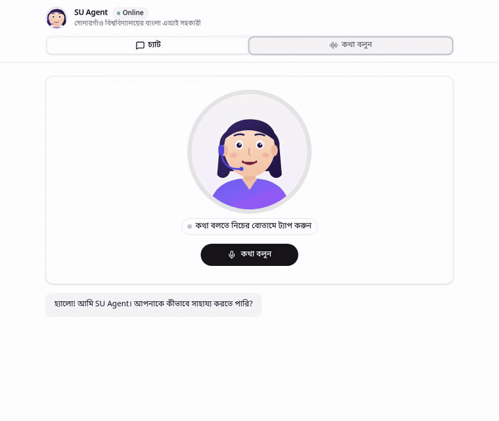

# SU Agent — Bangla AI assistant for Sonargaon University

**Live demo:** https://su-agent-246s.vercel.app

An AI agent that answers questions about Sonargaon University in Bangla — by text or by voice,
with a talking, lip-syncing avatar.

| 💬 Chat mode | 🎙️ Talk mode |
| :---: | :---: |
|  |  |
| Type a question; the agent searches the university knowledge base and replies in Bangla. | Tap and speak in Bangla; the agent transcribes, answers, and speaks the reply while the avatar animates (listening → thinking → speaking). |

## How it works

- **Next.js** app — UI and API on one origin, deployed on **Vercel**.
- **LangGraph** ReAct agent on **Gemini**, with a `search_knowledge` tool over **Qdrant** (RAG on `data/*.txt`).
- **Memory:** conversations persist in **PostgreSQL** (Neon), so context survives restarts.
- **Voice:** Gemini text-to-speech for natural replies; speech-to-text via the browser or `/api/stt`.

## Run locally

```bash
npm ci
cp .env.example .env.local   # add Google AI, Qdrant and PostgreSQL credentials
npm run init:memory          # create memory tables
npm run seed:knowledge       # index data/*.txt into Qdrant
npm run dev                  # http://localhost:3000
```

`npm test`, `npm run lint` and `npm run typecheck` run the checks.

> Demo project — no authentication or rate limiting. Not production-ready.
